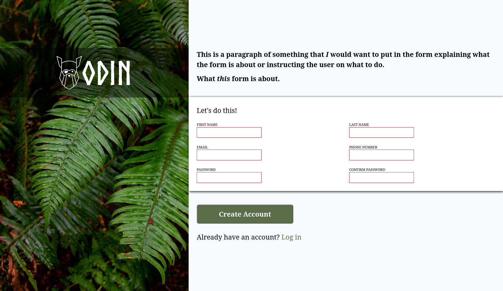

# Sign-Up Form

A responsive and visually modern sign-up form web page created as part of [The Odin Project](https://www.theodinproject.com/) Intermediate HTML and CSS curriculum.

🔗 **Live Demo**: [https://akil4.github.io/signup-form/](https://akil4.github.io/signup-form/)

---

## 📸 Screenshot

---

## 🚀 Overview

This project showcases a clean split-screen sign-up interface featuring dynamic input validation, fluid typography, responsive layout scaling, and custom branding typography.

### Features
- **Split-Screen Design**: Hero image sidebar paired with a structured form area.
- **Fluid Design & Typography**: Built using Utopia fluid clamp calculations for responsive text sizing and spatial utility tokens.
- **Form Validation**: Interactive HTML5 input validation styling (focus, valid, and invalid states).
- **CSS Architecture**: Organized custom CSS properties and a modern reset baseline.

---

## 🛠️ Built With

- **HTML5**: Semantic tags (`<main>`, `<section>`, `<form>`, `<label>`, `<input>`)
- **CSS3**:
  - Flexbox & CSS Grid layouts
  - Custom Properties (CSS Variables)
  - Fluid Clamps (Typography & Spacing)
- **Vanilla JavaScript**: Project logic entry point (`main.js`)

---

## 🎨 Attributions & Credits

Special thanks to the creators and tools that made this project possible:

- **Logo**: Odin logo provided by [The Odin Project](https://www.theodinproject.com/) ([Direct Asset Link](https://raw.githubusercontent.com/TheOdinProject/curriculum/5f37d43908ef92499e95a9b90fc3cc291a95014c/html_css/project-sign-up-form/odin-lined.png)).
- **Background Image**: Green leaf plant close-up photo available on [Unsplash](https://unsplash.com/photos/green-leaf-plant-in-close-up-photography-25xggax4bSA).
- **Font**: [Norse Font](https://www.joelcarrouche.com/fonts/norse) designed by Joël Carrouché.
- **Fluid Design System**: Generated using [Utopia](https://utopia.fyi/) for fluid type and space scaling.
- **CSS Reset**: [Josh W. Comeau's Custom CSS Reset](https://www.joshwcomeau.com/css/custom-css-reset/).

---

## 💻 Getting Started

To view the project locally:

1. Clone or download this repository.
2. Open `index.html` directly in your web browser, or launch it with a live server extension (e.g., VS Code Live Server).
