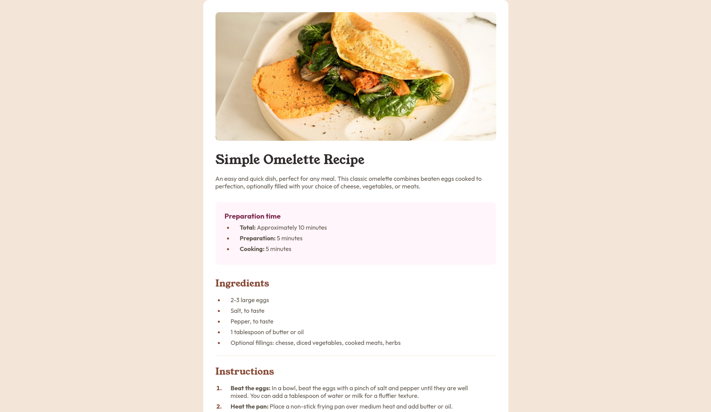
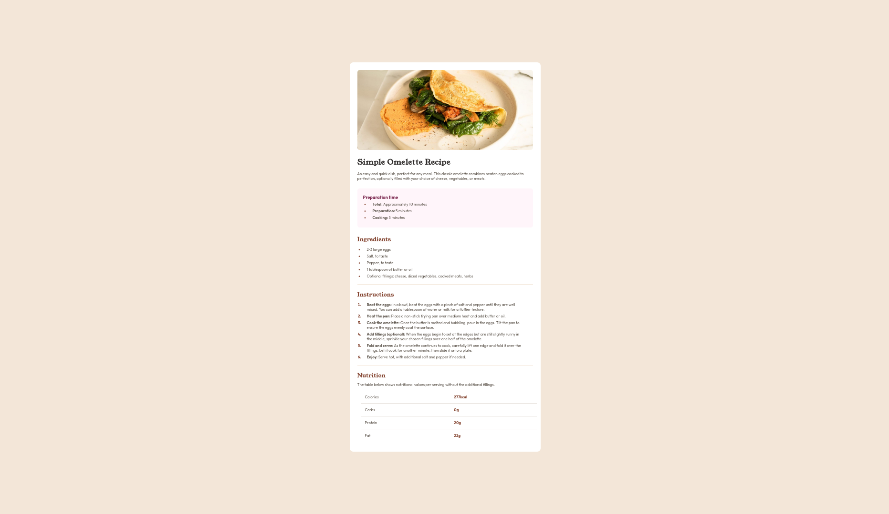
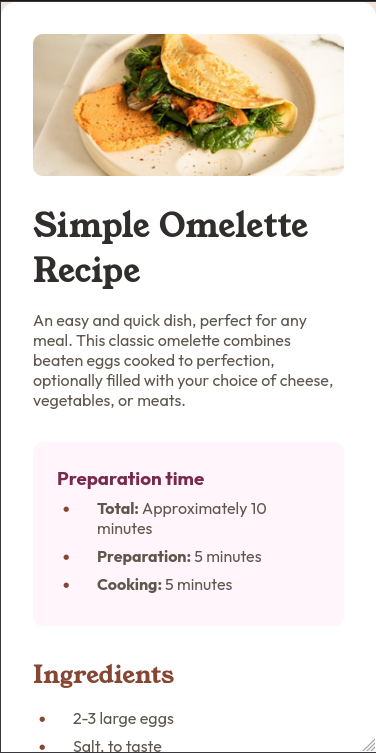

# Frontend Mentor - Recipe page solution

This is a solution to the [Recipe page challenge on Frontend Mentor](https://www.frontendmentor.io/challenges/recipe-page-KiTsR8QQKm). Frontend Mentor challenges help you improve your coding skills by building realistic projects. 

## Table of contents

- [Overview](#overview)
  - [The challenge](#the-challenge)
  - [Screenshot](#screenshot)
  - [Links](#links)
- [My process](#my-process)
  - [Built with](#built-with)
  - [What I learned](#what-i-learned)
  - [Continued development](#continued-development)
  - [Useful resources](#useful-resources)
- [Author](#author)
- [Acknowledgments](#acknowledgments)

## Overview

### Screenshot

### Links

- Solution URL: [https://github.com/akil4/recipe-page](https://github.com/akil4/recipe-page)
- Live Site URL: [https://akil4.github.io/recipe-page/](https://akil4.github.io/recipe-page/)

## My process

### Built with

- Semantic HTML5 markup
- CSS custom properties
- Flexbox
- HTML Tables
- Desktop-first workflow

### What I learned

I learned that i don't have to make every styles unique, it is just easier and better to make my styles in a single declaration. I also think it makes the code more readable.

### Continued development

I am stuck in a position where I think the solution is simple but can't make my head come around it. So the problem is that i am not able to make my site close to the design, But it looks exactly similar when i zoom out to 50%. I tried adjusting max-width of my main container, but failed miserably.

I would like to later make this a complete full blown recipe website that contains multiple recipes. Also the ability to search would be Great!

## Author

- Website - [Akil S](https://akil4.vercel.app)
- Frontend Mentor - [@akil4](https://www.frontendmentor.io/profile/akil4)
- LinkedIn - [Akil S](https://www.linkedin.com/in/akil4/)

## Acknowledgments

